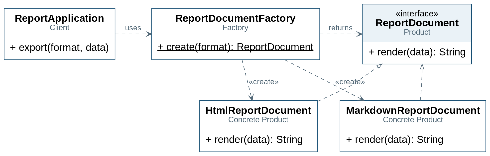
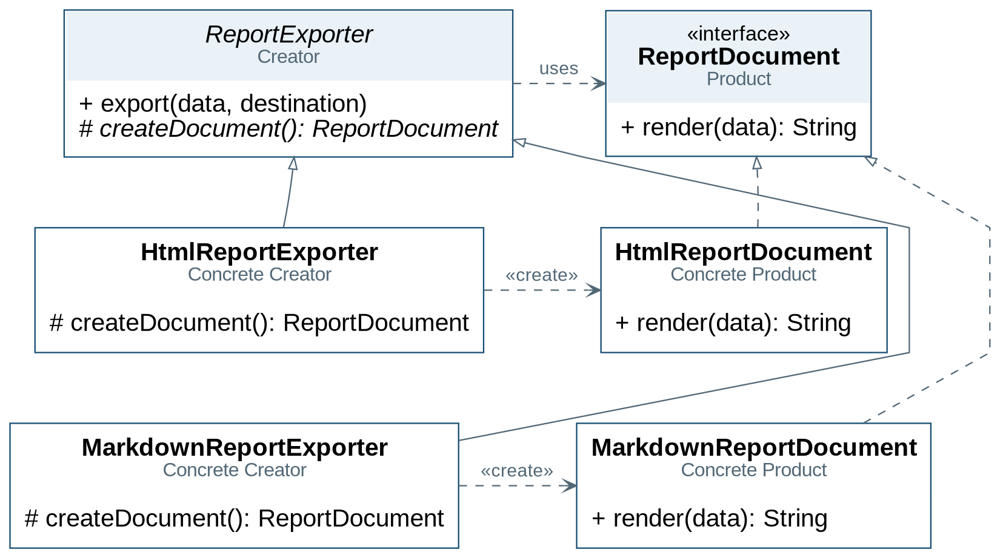
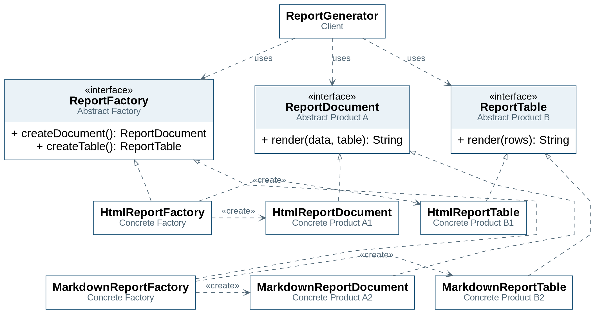

# A4.3 — Factories: aplicação para geração de relatórios

**Tópicos Avançados de POO · 2026/27 · Atividade de programação: 50 minutos**

## 1. Introdução

Nesta atividade, uma aplicação gera relatórios de resultados de uma turma em **HTML** e **Markdown**. O objetivo é organizar a criação dos objetos através de **Simple Factory**, **Factory Method** e **Abstract Factory**, identificando os participantes e as responsabilidades de cada abordagem.

A versão inicial, `baseline`, está funcional. Os dados, os produtos concretos e a formatação estão implementados; deverá completar os **10 métodos assinalados com `TODO`**, distribuídos pelas três etapas.

Trabalhe preferencialmente em pares, mantenha as interfaces e assinaturas fornecidas e concentre as alterações nos métodos indicados.

## 2. Atividade preparatória

1. **Abrir o projeto:** importe a pasta que contém `pom.xml` como projeto Maven no IntelliJ IDEA e utilize **JDK 17 ou superior**.

2. **Explorar a estrutura:** analise as classes de `model`, os documentos de `documents` e o cliente `baseline.ReportApplication`. Localize os packages das etapas: `simplefactory`, `factorymethod` e `abstractfactory`.

3. **Verificar a base:** execute apenas os testes da classe `FoundationTest`, disponíveis em `src/test/java`. Estes devem passar antes de iniciar as implementações.

4. **Executar a versão inicial:** em **Run → Edit Configurations…**, selecione a configuração **Application** da classe `Main`, indique `baseline` em **Program arguments** e execute-a.

5. **Consultar os resultados:** abra `target/reports/baseline-report.html` num navegador e `target/reports/baseline-report.md` na pré-visualização Markdown do IDE. Confirme os **3 estudantes** e a média **11.33**.

Ao desenvolver cada etapa, altere o argumento do `Main` para `simple`, `method` ou `abstract` e execute, respetivamente, `SimpleFactoryTest`, `FactoryMethodTest` ou `AbstractFactoryTest`. Estes testes poderão falhar enquanto a implementação correspondente estiver incompleta. O argumento `all` permite executar todas as variantes.

> **Atenção aos contratos:** nas etapas 1 e 2, `documents.ReportDocument` utiliza `render(data)`; na etapa 3, `abstractfactory.ReportDocument` utiliza `render(data, tableContent)`, recebendo uma tabela produzida separadamente. Verifique os imports para utilizar a interface adequada.
## 3. Guião de trabalho — 50 minutos

| Etapa | Tempo | Objetivo |
|---|---:|---|
| 1 — Simple Factory | 8 min | Centralizar a escolha e criação do documento |
| 2 — Factory Method | 22 min | Reutilizar a exportação, deixando a criação às subclasses |
| 3 — Abstract Factory | 15 min | Obter documento e tabela da mesma família |
| 4 — Verificação e reflexão | 5 min | Comparar resultados e justificar as decisões |

### Etapa 1 — Simple Factory · 8 minutos

**Problema:** o cliente escolhe classes concretas e chama os seus construtores. Outros clientes poderão repetir a decisão.

1. Analise `baseline.ReportApplication` e compare os dois ficheiros gerados.
2. Identifique a seleção do formato e as chamadas aos construtores.
3. Complete **SF1**, em `simplefactory.ReportDocumentFactory.create(format)`, para fornecer o documento correspondente a cada valor de `ReportFormat`.
4. Complete **SF2**, em `simplefactory.ReportApplication.export(data, format, destination)`, usando a fábrica para obter o documento, gerar o conteúdo e guardar o ficheiro.
5. Execute os testes e a variante "simple".

**Critério de conclusão:** ambos os formatos são gerados. O cliente de `simplefactory` depende da fábrica e da interface do produto, sem instanciar ou importar documentos concretos.

**Participantes:** Factory: `ReportDocumentFactory`; Product: `documents.ReportDocument`; Concrete Products: `HtmlReportDocument` e `MarkdownReportDocument`; Client: `simplefactory.ReportApplication`.

**Prós:** criação centralizada e poucos participantes. **Contras:** acrescentar um formato exige alterar a fábrica com a seleção condicional.

### Etapa 2 — Factory Method · 22 minutos

**Novo requisito:** acrescentar formatos através de subclasses, reutilizando o processo de exportação.

1. Analise `ReportExporter` e a declaração de `createDocument()`.
2. Complete **FM1**, em `ReportExporter.export(data, destination)`, utilizando o produto obtido através do factory method.
3. Complete **FM2**, em `HtmlReportExporter.createDocument()`.
4. Complete **FM3**, em `MarkdownReportExporter.createDocument()`.
5. Execute os testes e a variante: "method"

**Critério de conclusão:** o processo comum usa a interface do produto. As subclasses decidem o documento criado. O método `export()` funciona também com um criador diferente dos dois já fornecidos.

O teste `commonProcessUsesTheOverriddenFactoryMethod` verifica precisamente esse último requisito através de um criador adicional definido no teste.

**Participantes:** Creator: `ReportExporter`; Concrete Creators: `HtmlReportExporter` e `MarkdownReportExporter`; Product e Concrete Products: os mesmos da etapa 1.

**Prós:** reutiliza a exportação e permite estender a criação por subclasses. **Contras:** introduz uma hierarquia adicional de criadores. A configuração continua a ter de selecionar um criador concreto.

### Etapa 3 — Abstract Factory · 15 minutos

**Novo requisito:** além dos relatórios completos, queremos tabelas de resultados reutilizáveis noutros documentos. Documento e tabela devem pertencer à mesma família.

| Família | Documento fornecido | Tabela fornecida |
|---|---|---|
| HTML | `abstractfactory.products.HtmlReportDocument` | `HtmlReportTable` |
| Markdown | `abstractfactory.products.MarkdownReportDocument` | `MarkdownReportTable` |

1. Analise as interfaces `ReportFactory`, `ReportDocument` e `ReportTable` do package `abstractfactory`.
2. Complete **AF1** e **AF2**, em `HtmlReportFactory`.
3. Complete **AF3** e **AF4**, em `MarkdownReportFactory`.
4. Complete **AF5**, em `ReportGenerator.generate(data)`, usando os produtos obtidos da fábrica recebida no construtor para compor o relatório.
5. Execute os testes e a variante:"abstract"

**Critério de conclusão:** o gerador trabalha com as interfaces e recebe a família através da fábrica. Deve funcionar com outra fábrica que respeite os contratos, sem alteração do seu código.

O teste `generatorUsesBothProductsSuppliedByItsFactory` verifica se o gerador utiliza os produtos da fábrica recebida.

**Participantes:** Abstract Factory: `ReportFactory`; Concrete Factories: `HtmlReportFactory` e `MarkdownReportFactory`; Abstract Products: `abstractfactory.ReportDocument` e `ReportTable`; Client: `ReportGenerator`.

**Prós:** fornece os produtos relacionados de uma família através de contratos comuns. **Contras:** aumenta o número de classes; acrescentar um tipo de produto exige alterar o contrato da fábrica e todas as fábricas concretas.

**Limite desta implementação:** o conteúdo da tabela é uma `String`. O compilador não impede a combinação manual de formatos. A coerência decorre de obter os produtos da mesma fábrica e de respeitar os contratos.

### Etapa 4 — Verificação e reflexão · 5 minutos

Execute todos os testes e gere os resultados das quatro variantes: "all"

Compare os relatórios HTML entre si e os relatórios Markdown entre si: **o conteúdo deve manter-se igual ao da versão inicial**.

Registe as respostas em [REFLECTION.md](REFLECTION.md):

1. Onde se decide qual a classe concreta a instanciar em cada variante?
2. Para acrescentar um formato, que classes é necessário criar ou alterar em cada abordagem?

Reveja também as dependências: os testes verificam o comportamento; a inspeção do código e do UML permite confirmar a distribuição de responsabilidades.

## 5. Comandos de execução e testes

Os perfis de etapa são **independentes**. Utilize um perfil de cada vez, ou `all-stages` para verificar o conjunto.

No IDE, executar todos os testes diretamente pode ativar também os testes das etapas incompletas. Para acompanhar a atividade, execute a classe de testes da etapa ou utilize os comandos Maven acima.

Enquanto uma etapa estiver incompleta, a execução da respetiva variante termina com uma mensagem `Activity incomplete: TODO ...`. Este comportamento identifica o trabalho pendente.

## 4. Checklist final

- [ ] Os 10 métodos assinalados foram completados.
- [ ] A seleção da Simple Factory está centralizada na fábrica.
- [ ] O processo do Factory Method chama o método que as subclasses redefinem.
- [ ] O cliente do Abstract Factory obtém e utiliza os dois produtos da fábrica recebida.
- [ ] Todos os testes de `all-stages` passam.
- [ ] Os ficheiros de saída preservam o conteúdo da versão inicial.
- [ ] As duas respostas de `REFLECTION.md` estão preenchidas.

## 5. Atividade complementar — família Plain Text

Na variante Abstract Factory, acrescente:

- `PlainTextReportDocument` e `PlainTextReportTable`, implementando as interfaces desta variante.
- `PlainTextReportFactory`, que disponibiliza os dois produtos.
- Um ponto de execução e testes que utilizem a nova fábrica.

**Objetivo:** confirmar que `ReportGenerator` continua a funcionar sem alterações. Pode começar por executar o gerador com a nova fábrica num pequeno programa independente; a alteração do enum partilhado não é necessária para demonstrar a extensão.

Esta atividade fica fora dos 50 minutos principais.

